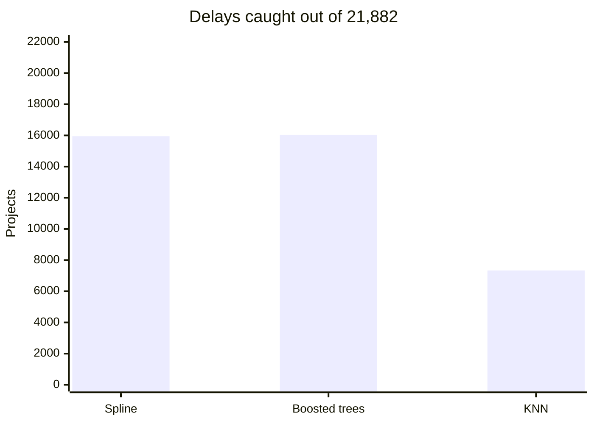

# CMSC 170 Project, Milestone 3: Comparison

**Group Name:** Fantastic 4 vs. VON Doom

**Group Members:**

* Aluag, Zander Ian C. (zianaluag)
* Caraig, Bernard Alejandro C. (herio-nn)
* Perez, Desmond Rainier B. (desmondperez)
* Tandang, Frannieczeska Erene U. (ririlinn)

**Repository:** https://github.com/zianaluag/comparative-ml-study

## Methods and evaluation

We trained all three models on the same 170,734 projects and tested them on the same 42,684. Our [evaluation function](../src/classification_metrics.py) counted correct flags, false alarms, missed delays, and projects correctly left unflagged. We calculated accuracy, precision, recall, and F1 from those four counts.

## Comparison

| Method | Accuracy | Precision | Recall | F1 |
| --- | ---: | ---: | ---: | ---: |
| Spline logistic regression | 64.08% | 62.93% | 72.89% | 0.6754 |
| Gradient boosted trees | 67.47% | 66.60% | 73.30% | 0.6979 |
| KNN | 59.95% | 74.22% | 33.52% | 0.4618 |

Boosted trees caught 91 more delays than spline regression and raised 1,354 fewer false alarms. KNN had the highest precision, but it missed 14,547 delays.

## Progress so far

* Bernard - Switched from category frequencies to delay rates from the training data.
* Desmond - Put the scoring code in one function and added a menu for spline regression and KNN.
* Frannie - Added the spline and KNN confusion matrices, the regional map, and the delay chart by project type.
* Ian - Added boosted trees to the menu and put the scores for all three models in the README.

## Problems so far

* Some categories could appear for the first time in the test set. For those, we used the overall delay rate from the training set.
* KNN was often right when it raised a flag. Looking at precision alone hid how many delays went unflagged.

## Plans for Milestone 4

* Put the score table beside the confusion matrices on the project page.
* Explain which model we would use for a schedule check and what its mistakes would mean for a district office.
